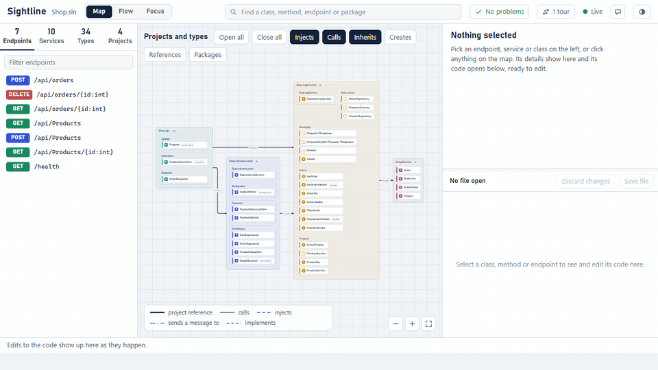

# Sightline

[](https://www.nuget.org/packages/Co.Revington.Sightline)
[](https://www.nuget.org/packages/Co.Revington.Sightline)
[](https://github.com/ravindu-rev/sightline/actions/workflows/release.yml)
[](LICENSE)

A live, editable map of a .NET solution. It reads your code with Roslyn and shows, in one page:

- projects, NuGet packages and how projects use each other
- namespaces and types
- dependency injection: which class is registered for which service, and with what lifetime
- HTTP endpoints (controllers, minimal APIs, SignalR hubs, gRPC services)
- the flow behind each endpoint: handler, services, repositories, database and outbound HTTP calls
- problems: a singleton that holds a scoped service, a service nobody registered, circular dependencies, broken layer rules

The map redraws while you edit, and with your app running it also shows what the app really does: the services it registered, the endpoints it mapped, and every request it handles, down to the SQL it ran.



**[Try the live demo at sightline.revington.co](https://sightline.revington.co/)**. It runs in the browser; nothing to install.

## Get started

Needs the .NET 10 SDK or newer. The package is `Co.Revington.Sightline`; the command is `sightline`.

**Try it** without installing anything. In a folder with a `.sln`:

```sh
dnx Co.Revington.Sightline
```

**Set it up for your solution**, so the whole team has it. In the folder with your `.sln`, usually the root of the repository:

```sh
dnx Co.Revington.Sightline init
```

`init` pins Sightline in the repository's tool manifest (`dotnet-tools.json`), writes [`sightline.json`](#settings) naming the solution, and adds a "Sightline: open the map" task to `.vscode/tasks.json` when the folder uses VS Code. Running it again changes nothing that is already set up. Commit the files it lists; from then on, anyone who clones the repository runs:

```sh
dotnet tool restore
dotnet sightline
```

`dotnet sightline` works from any folder in the repository. Projects that were never restored are restored first, as `dotnet build` does.

**Add it to the app you run**, so the map opens beside it every time you run a Debug build:

```sh
dotnet add package Co.Revington.Sightline.Hosting
```

```text
Sightline: the live map of this solution is at http://localhost:5210 (or open /sightline on this app)
```

With the app running, the map gets [what the app really does](#the-running-app): its real registrations and endpoints, every request it handles, and **Try it** on each endpoint. Only Debug builds of apps get the package's code; Release builds, test projects, CI runs and tools that load the app (such as `dotnet ef`) are left alone, and no assembly is added to the app. The map stays open across restarts (`dotnet watch`, a new debug session) and closes 10 seconds after the app stops. Turn it off with `<SightlineAutoStart>false</SightlineAutoStart>` in the project file, or `SIGHTLINE_AUTOSTART=0` for one run; `<SightlineOpenBrowser>true</SightlineOpenBrowser>` also opens the browser.

**In VS Code**, the [Sightline extension](https://marketplace.visualstudio.com/items?itemName=revington.sightline) opens the map from the status bar, shows the method under the cursor on the map (**Show in Sightline**, `Ctrl+Alt+M`), and lists Sightline's problems in the Problems panel.

**For AI assistants**, `sightline mcp` serves the map over the [Model Context Protocol](https://modelcontextprotocol.io), so an assistant can ask how the code fits together instead of searching files. In VS Code, `.vscode/mcp.json`:

```json
{
  "servers": {
    "sightline": {
      "type": "stdio",
      "command": "dnx",
      "args": ["Co.Revington.Sightline", "--yes", "--", "mcp", "${workspaceFolder}"]
    }
  }
}
```

In Claude Code: `claude mcp add sightline -- dnx Co.Revington.Sightline --yes -- mcp`. In a repository set up with `init`, `dotnet sightline mcp` works too. The tools give an overview of the solution, find symbols, list endpoints and services, trace a request or method both ways, describe a type, list problems, and show what depends on something.

**In CI**, `sightline check` fails the build on problems, and the [Sightline GitHub Action](https://github.com/ravindu-rev/sightline-action) comments on each pull request with what it does to the map:

```yaml
on: pull_request
permissions:
  contents: read
  pull-requests: write
jobs:
  map:
    runs-on: ubuntu-latest
    steps:
      - uses: actions/checkout@v7
      - uses: ravindu-rev/sightline-action@v1
```

**Install it just for yourself**: `dotnet tool install --global Co.Revington.Sightline`, then run `sightline` in any solution folder.

## Commands

```sh
sightline [path] [options]            # open the map
sightline init [folder]               # set a solution up for everyone who works on it
sightline check [path]                # list problems; exit code 1 when there are errors
sightline export [path] --out <dir>   # the map as a static website anyone can open
sightline diff [path] --base <ref>    # what a change does to the map, for pull requests
sightline mcp [path]                  # serve the map to AI assistants
```

The path is a `.sln`, `.slnx` or `.csproj` file, or a folder. Without it, Sightline opens the solution named in the nearest `sightline.json`, or the nearest solution in the current folder or above it, up to the top of the repository. The map opens in the browser at `http://localhost:5210`.

| Option | What it does |
| --- | --- |
| `--port <n>` | Port for the map page. The next free one is used if it is busy. |
| `--no-open` | Do not open the browser. |
| `--no-restore` | Do not run `dotnet restore` for projects that were never restored. |
| `--version` | Show the version. |
| `init --solution <file>` | The solution to open, when the folder has several. Without it, `init` asks. |
| `init --vscode`, `init --no-vscode` | Add the VS Code task even without a `.vscode` folder, or never. |
| `init --no-tool` | Do not pin Sightline in the tool manifest. |
| `check --format text\|json\|github` | `github` writes annotations and a job summary for GitHub Actions; it is the default inside Actions. |
| `check --fail-on error\|warning\|info\|never` | Which problems make the exit code 1. Default `error`. |
| `export --out <folder>` | Write a static website. Host the folder anywhere, such as GitHub Pages; browsers do not run it straight from disk. |
| `export --json <file>` | Write the map as JSON, the input of `diff`. |
| `export --no-source`, `--source-url <url>` | Leave the source code out, or load it from an address with `{path}` in it, such as `https://raw.githubusercontent.com/owner/repo/<commit>/{path}`. |
| `diff --base <ref>` | Compare the working tree with a commit, branch or tag. Or give two files written by `export --json`. |
| `diff --format markdown\|text\|json`, `--out <file>` | Markdown is ready for a pull request comment. |
| `diff --fail-on error\|warning\|never` | Exit with 1 when the change adds problems of this level. |

Exported maps and `diff` never contain paths from your machine: files are shown relative to the repository, and load warnings are left out.

## Problems

Sightline checks the dependency injection setup and your layer rules as you type. Problems show as a dot on the map, under the **Problems** button, in `sightline check`, in pull request comments and in VS Code's Problems panel.

| Check | Default | What it finds |
| --- | --- | --- |
| `captive-dependency` | error | A singleton (or a hosted service, or middleware written by convention) that receives a scoped service, directly or through transient ones. It keeps one instance for the life of the app; ASP.NET Core refuses this in Development. |
| `missing-registration` | warning | A class or endpoint that receives a service nobody registered. Creating it fails at run time. |
| `dependency-cycle` | error | Services that need each other to be created. |
| `layer-violation` | error | A project that uses a higher layer, or something a rule says it may not use. |
| `unused-registration` | info | A registration nothing in the solution asks for. |

Layer rules live in `sightline.json`:

```json
{
  "layers": ["*.Api", "*.Infrastructure", "*.Application", "*.Domain"],
  "rules": [{ "from": "*.Domain", "mayNotUse": ["Microsoft.EntityFrameworkCore*"], "because": "the domain stays free of persistence" }],
  "checks": { "unused-registration": "off" }
}
```

Layers go from the top down; a project may use its own layer and the ones below. Reading code cannot see everything, so the map also lists what it **could not follow**: services registered by scanning assemblies (Scrutor, MediatR, FluentValidation), services looked up by a type worked out at run time, endpoints from frameworks it does not read yet (FastEndpoints, Carter, Razor Pages), and calls that did not resolve because packages are missing. With assembly scanning in the solution, a missing registration is only a note, since the scan may register it. With the app running, its real registrations count, and the uncertainty goes away.

## The running app

With `Co.Revington.Sightline.Hosting` in the app, the app reports to the map once it has started:

- **What it registered and mapped.** Endpoints the app confirms are marked; registrations and endpoints only the app knows about, such as those from assembly scanning or FastEndpoints, are added to the map and to the checks.
- **Every request it handles**, under **Requests**: status, time, the database commands it ran (EF Core) and its outbound HTTP calls. Pick one to see it in full, and to light the path it took on the flow of its endpoint.
- **Try it** on an endpoint: a request built from the handler's parameters (route, query, headers, and a sample JSON body from the body type) is sent to the app, and the answer shows beside the code. Tick "Send again whenever the code is saved" to see each change take effect.

Everything stays on your machine. Requests from the page only ever go to apps on `localhost`.

## Settings

`sightline.json` holds the settings for a repository. Sightline uses the nearest one in the current folder or a folder above it, and options on the command line win over it.

```json
{
  "$schema": "https://sightline.revington.co/sightline.schema.json",
  "solution": "Shop.sln",
  "exclude": ["*.Tests", "samples"]
}
```

| Setting | Default | What it does |
| --- | --- | --- |
| `solution` | the nearest solution | The `.sln`, `.slnx` or `.csproj` file to open, relative to `sightline.json`. |
| `exclude` | none | Projects to leave off the map. Each entry is a project name, a folder or a path relative to `sightline.json`, and may use `*` within a folder name and `**` across folders: `"*.Tests"`, `"samples"`, `"tools/**"`. Left-out projects still load when others reference them, so the code that uses them is read correctly. |
| `port` | `5210` | Port for the map page. |
| `openBrowser` | `true` | Open the map in the browser at start. |
| `restore` | `true` | Run `dotnet restore` first for projects that were never restored. |
| `layers`, `rules`, `checks` | none | Layer rules and how serious each problem is; see [Problems](#problems). |
| `editor` | detected | The editor that **Open in editor** starts: `vscode`, `cursor`, `rider` or `visualstudio`. A command of your own goes in the `SIGHTLINE_EDITOR` environment variable, such as `subl {file}:{line}`; a repository cannot name a program to run. |

The `$schema` line lets editors suggest these settings as you type. Comments and trailing commas are allowed. A misspelled setting is reported and ignored; a wrong value stops Sightline with a message saying what is expected.

## The three views

| View | Shows | Use it to answer |
| --- | --- | --- |
| Map | Projects as zones, types listed per namespace. Hover or select a type to see its lines. | What is in this solution? Which project uses which? |
| Flow | Every step behind an endpoint or method, numbered in source order. Interface calls continue in the registered implementation. | What happens when this endpoint is hit? Who ends up calling this method? |
| Focus | One type in the middle, between what uses it and what it depends on. | What breaks if I change this class? |

The left panel lists endpoints, services, types and projects. The right panel shows details of the selection, its problems, and its source code.

The address keeps the view and the selection, so a link opens the same picture for a teammate with the same solution, and in an exported map. Back and Forward work.

**Tours** walk a new teammate through the solution, one view at a time with a note on each. Write them in the page (**Tours**, then **New tour**); they are saved to `.sightline/tours/<name>.json`, so commit them to share.

Shortcuts: `/` find, `1` `2` `3` switch view, `F` fit to screen, double-click to open a project, focus a type or re-root a flow.

## Editing

- **In the page:** type in the code panel. The map updates as you type, before anything is saved. `Ctrl+S` or **Save file** writes to disk; **Discard changes** goes back to the file on disk.
- **In your editor:** save the file and the map follows. With auto-save on, it follows as you type. **Open in editor** jumps from the page to the same line in VS Code, Cursor, Rider or Visual Studio.

The strip at the bottom logs what each edit changed, for example `GetOrderHandler.Handle calls IOrderRepository.SaveAsync`.

## Share a map

`sightline export --out site` writes the map as a static website: the same page, read-only, with the code bundled. Host it on GitHub Pages or any web server, and add a badge to your README:

```markdown
[](https://<you>.github.io/<repo>/)
```

## Limits

- C# only. SDK-style projects.
- Reading code follows constructor injection, interface implementations, overrides and MediatR-style `Send`/`Publish` to handlers. Reflection, assembly scanning and generated code are listed under "Not followed" instead; with the app running, its own report fills those gaps for registrations and endpoints.
- Endpoint discovery covers controllers, minimal APIs (including `MapGroup` prefixes passed through extension methods), `MapHub`, `MapGrpcService` and `MapHealthChecks`. Other frameworks' endpoints come from the running app.
- Property reads and writes are not counted as calls.
- Size: measured on jellyfin (41 projects, 2,300 types) and nopCommerce (40 projects, 4,150 types), a solution loads in 20 to 30 seconds and an edit reaches the open map in under a second. Very large flows stop at 160 steps and show "+N" where they stop.

## Safety

The server listens on localhost only. Every API call needs a token that is generated at start and embedded in the page, so other websites cannot read or write your source through the browser. Only files that belong to the loaded solution can be read, saved or opened in an editor. **Try it** only sends requests to apps on this machine. Apps report to the map with the same token, which the map hands only to the app that started it.

## Working on Sightline

```sh
dotnet run --project src/Co.Revington.Sightline -- samples/Shop/Shop.sln   # run from source on the bundled sample
dotnet test                                                               # end-to-end tests
```

- `src/Co.Revington.Sightline/Analysis` loads the solution through MSBuild, extracts facts per file (declarations, calls, DI registrations, endpoints, constructor dependencies), builds the graph and runs the checks.
- `src/Co.Revington.Sightline/Live` watches the folder. A changed file is re-read alone, the graph is rebuilt, and only the difference is pushed to the browser.
- `src/Co.Revington.Sightline/Server` is the local web server: the page, the API, "Try it", and what running apps report.
- `src/Co.Revington.Sightline/Commands` and `Mcp` are `check`, `export`, `diff` and `mcp`.
- `src/Co.Revington.Sightline/wwwroot` is the page: plain JavaScript modules, ELK for layout, CodeMirror for the editor. No build step. Add `--ui src/Co.Revington.Sightline/wwwroot` when running to serve these files straight from source.
- `src/Co.Revington.Sightline.Hosting` packs the tool with the build files that start it beside an app, and the code that reports the app's registrations, endpoints and requests.
- `vscode/` is the VS Code extension: plain JavaScript, no dependencies.
- `site/` is the website. `node site/generate.mjs --serve` builds it into `_site/` and previews it at `localhost:4173`. The demo on the site is the tool's own page, fed by a recording that the script takes from the real tool running on `samples/Shop`, so it cannot drift from the product.

## Releasing

Releases are automatic. Every push to `master` is built and tested by `.github/workflows/release.yml`. If code under `src/` or `vscode/` changed, a second job then:

1. works out the next version from the commit messages since the last release
2. publishes both NuGet packages to nuget.org from the GitHub environment `production`
3. packages the VS Code extension with the same version
4. tags the commit `vX.Y.Z` and creates a GitHub release with notes and the packages attached

A third job then publishes the extension from that release to the VS Code Marketplace, and to Open VSX when its token is set.

| Commit message starts with | Version change | Example |
| --- | --- | --- |
| `feat!:` (or the body has a `BREAKING CHANGE:` line) | major, or minor while the version is 0.x | 0.3.1 to 0.4.0 |
| `feat:` | minor | 0.3.1 to 0.4.0 |
| anything else | patch | 0.3.1 to 0.3.2 |

Both packages, `Co.Revington.Sightline` and `Co.Revington.Sightline.Hosting`, are released together with the same version. To jump to a specific version such as 1.0.0, set `<VersionPrefix>` in `src/Directory.Build.props`. To release without a code change, start the workflow by hand from the Actions tab. To publish only the extension of the latest release again, for example after a marketplace was down, start it by hand with **Only publish the VS Code extension of the latest release** ticked. Release notes leave out `ci`, `test`, `chore`, `docs`, `build` and `style` commits. Pull requests are built and tested on Linux, Windows and macOS by `.github/workflows/ci.yml`, get a comment with what they do to the map, and never publish.

### Publishing setup

nuget.org and the VS Code Marketplace both use trusted publishing, so no API key or token for them is stored anywhere. These settings have to agree:

| Where | Setting | Value |
| --- | --- | --- |
| nuget.org, Trusted Publishing policy | Repository owner, repository | `ravindu-rev`, `sightline` |
| nuget.org, Trusted Publishing policy | Workflow file, environment | `release.yml`, `production` |
| GitHub, repository variable `NUGET_USER` | nuget.org user name that created the policy | `revington.co` |
| VS Code Marketplace, publisher `revington`, Trusted Publishing policy | Repository owner, repository | `ravindu-rev`, `sightline` |
| VS Code Marketplace, publisher `revington`, Trusted Publishing policy | Workflow file, environment | `release.yml`, `production` |

The GitHub environment `production` only accepts deployments from `master`. If `NUGET_USER` is empty, the workflow still builds and tests every push but skips the release and says why.

Optional, each one switched on by adding it in the repository's settings:

| GitHub setting | What it turns on |
| --- | --- |
| Secret `OVSX_PAT` | Publishing the extension to Open VSX, for Cursor, VSCodium and other VS Code forks. |
| Variable `CF_ANALYTICS_TOKEN` | Cloudflare Web Analytics on the website (no cookies). |
